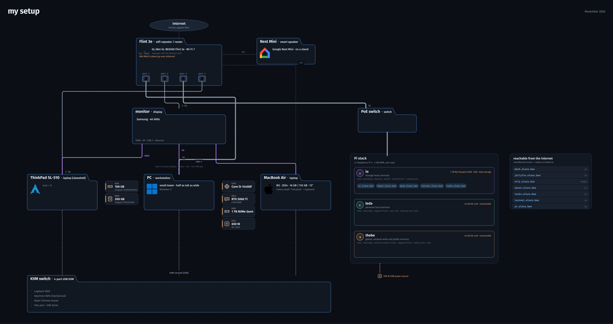

<h1 style="centered">rpi</h1>

config and a fleet cli for three raspberry pis, connected over tailscale

◑ [thebe](<https://en.wikipedia.org/wiki/Thebe_(moon)>) · ◐ [leda](<https://en.wikipedia.org/wiki/Leda_(moon)>) · ◒ [io](<https://en.wikipedia.org/wiki/Io_(moon)>)



## diagram

the picture above is generated, not drawn: the desk hardware comes from
`inventory.yaml`, the three pis' names, colors, blurbs, services and apps come
straight from `apps.toml` / `hosts/*/host.toml` / `dns.toml` by way of
`cli/manifest.py`, so it can't drift from the fleet config. a push that
touches any of those regenerates and commits `docs/diagram.*` automatically
(see `.github/workflows/diagram.yml`). to do it yourself:

```
uv sync && uv run fetch_icons.py && uv run diagram.py
```

## layout

each app is one directory at the root: a Go api in `server/`, a ui in `web/`
that the api embeds, and its openrc unit next to them. the ui is Astro for the
read-mostly services and React for `tasks`; the tooling runs each app's own
`dev`, `build` and `typecheck` scripts rather than knowing which. `apps.toml`
is the only place that knows an app exists, and everything else reads it.

```
ytdl/ share/ dash/           the apps
torrent/ tasks/
apps.toml                    ports, domains, which host runs what
dns.toml                     every name the fleet resolves
hosts/<name>/                one pi: host.toml, Caddyfile, install
internal/                    Go helpers the apis share
shared/ui/                   palette, fonts, html shell, fetch glue
shell/ bin/                  what gets pushed to the pis
cli/                         everything pi does
pi                           wrapper for the cli to be on path
inventory.yaml               the desk diagram's hardware layer (see "diagram")
diagram.py fetch_icons.py    renders docs/diagram.{svg,png}
```
